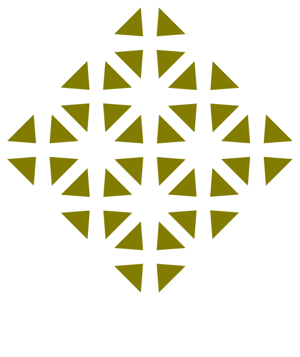
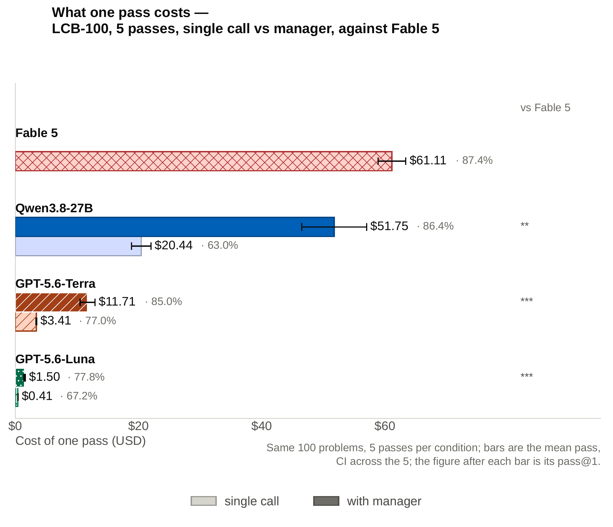

<h1 align="center"> Persis Capital Inc. Research</h1>

<p align="center">
<a href="https://arxiv.org/abs/2608.26480"></a>
<a href="https://news.ycombinator.com/item?id=50228167"></a>
<a href="LICENSE"></a>
<a href="LICENSE-CC-BY-4.0"></a>
</p>

<p align="center">
<a href="https://news.ycombinator.com/item?id=50228167" target="_blank" rel="noopener noreferrer"></a>
<a href="https://trendshift.io/repositories/225068?utm_source=trendshift-badge&amp;utm_medium=badge&amp;utm_campaign=badge-trendshift-225068" target="_blank" rel="noopener noreferrer"></a>
</p>

<p align="center">
<a href="#results">Results</a> | <a href="#running-the-code">Running the code</a> | <a href="#license">License</a>
</p>

---

<h3 align="center">GVS5H (Gorilla vs. 5 Humans): Five Qwen3.8-27B Models Match Claude Fable 5 on LiveCodeBench Hard</h3>

<div align="center">

</div>

## Results


*Opus 5 ran on an earlier version of the scaffold, in a single pass served through OpenRouter rather than five on a pinned backend.*




> **Abstract.** Frontier coding performance is typically bought with larger proprietary models at high cost. We introduce ledger-based zero-shot self-orchestration, a training-free method in which fresh instances of one model decompose problems and coordinate through a shared filesystem holding a plan, notes and current solution. Across eleven open and closed-weight models on the 100 latest hard LiveCodeBench problems, the method yields gains of up to 25.6 percentage points on pinned backends and offers two routes to frontier-level accuracy. Orchestrated Qwen3.8 Flash Next reaches 93.0% pass@1 against Fable 5's 90.4% at 9% of the cost, and locally served, open-weight Qwen3.8-27B rises from 66.8% to 92.4%. Gains are not universal: some models are unchanged or worse. Transcript analysis attributes the gain to decomposition and persistent context. Inference-time organization can approach frontier coding accuracy at a fraction of the cost, or slightly exceed it on self-hostable weights.
>
> — [the paper](https://arxiv.org/abs/2608.26480)

## Running the code

Needs [uv](https://docs.astral.sh/uv/) and an API key for the model you want to test.

```bash
cd codebase/v2-current
export OPENAI_API_KEY=...

LCB_RELEASE=release_v6 \
ESCALATION_CLOUD_MAX_TOKENS=128000 \
ESCALATION_CLOUD_TIMEOUT=7200 \
MULTIAGENT_MODEL=openai:gpt-5.6-terra \
uv run --no-project --python 3.12 --with 'datasets<4' --with numpy --with anthropic \
  python escalation/run_bench.py --engine multiagent --only lcb --lcb 100 --parallel 8
```

- `--engine multiagent` runs the manager; `--engine single` is the one-call baseline.
- Other models: `anthropic:<model>`, `dashscope:<model>`, `openrouter:<model>`, each with its own `*_API_KEY`.
- The pass@1 score prints at the end. Results are written to `runs/results.json`, workspaces to `runs/ws/`.

## License

Code is under the [MIT License](LICENSE). The paper, figures and run data are under
[CC BY 4.0](LICENSE-CC-BY-4.0). The LiveCodeBench fork, the benchmark problem statements
and the LaTeX template files keep their own licenses. See [NOTICE.md](NOTICE.md) for
which license covers which path.


